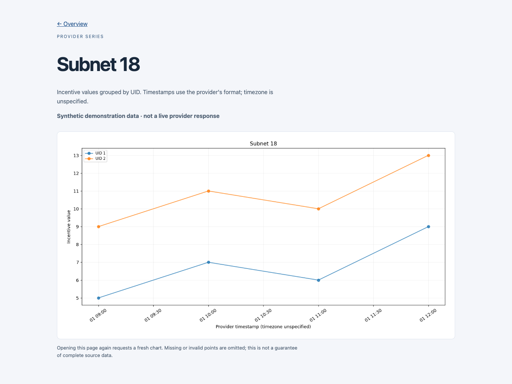

# Incentive series explorer

A Django page that requests subnet incentive history from a configured GraphQL endpoint, normalizes valid points, and renders a PNG line chart with Matplotlib. It consumes GraphQL; it does not implement a GraphQL server, return forecasting results, or calculate investment returns.



The preview above uses clearly labelled synthetic points generated offline. It is not a live provider response. [Mobile preview](docs/mobile.png) and the [standalone synthetic chart](docs/synthetic-chart.png) use the same fixture.

## Local setup

The repository pins Django 5.0.6 and Matplotlib 3.9.0. Use a separate Python environment:

```sh
python3 -m venv .venv
source .venv/bin/activate
pip install -r requirements.txt
export DJANGO_DEBUG=true
python manage.py migrate
python manage.py runserver 127.0.0.1:8000
```

Visit `/` for an overview. Opening `/plot/` makes one request to the configured provider and plots the response. Startup and the overview do not fetch incentive data.

Configuration is read from process environment variables; `.env.example` is a reference and is **not loaded automatically**. Defaults are `GRAPHQL_SUBNET_UID=18`, `GRAPHQL_API_URL=https://api.taomarketcap.com/graphql`, and `GRAPHQL_REQUEST_TIMEOUT=10` seconds. Override them explicitly for a permitted, compatible endpoint. No authentication header is implemented. Configure a private `DJANGO_SECRET_KEY` and explicit `DJANGO_ALLOWED_HOSTS` before disabling local debug. In explicit debug mode only, an absent signing key generates an ephemeral local key. Wildcard platform hosts are not trusted by default.

## Processing choices

The query requests `subnets(netUid: ...)`, UID incentives, values, and timestamps. Parsing accepts the nested `incentive` objects requested by that query, plus legacy flattened fixture shapes. Invalid containers, GraphQL error responses, non-finite/negative/boolean values, and unparseable timestamps are omitted or produce an empty result. Supported timestamps currently use `%Y-%m-%d:%H:%M:%S`; their timezone remains unspecified rather than silently calling them UTC.

Points are sorted by timestamp and grouped by UID. A request owns its `Figure` instead of using shared pyplot state. The chart title and HTML use the configured subnet, and the axes no longer add an arbitrary fifty-unit margin. The UI shows the data limitations and offers an overview link. Missing or failed data returns a generic 500 message; malformed partial data is not a completeness guarantee.

## Verification

```sh
DJANGO_DEBUG=true python manage.py test --settings=graphql.test_settings
```

Eleven Django tests pass with Django 4.2, Matplotlib 3.9, and an in-memory SQLite database. They exercise extraction, nested response shape, malformed/non-finite points, mocked HTTP failures, PNG generation, configured subnet rendering, and overview/error views. All Python files parse. A real Chrome session decoded the synthetic chart and checked desktop and 390px layouts without horizontal overflow. The historical full dependency environment, hosting manifests, and live provider were not verified. The retained Vercel URL is not advertised as a working deployment.

## Boundaries

There is no cache, persistence model for incentive samples, background scheduler, pagination, provider schema discovery, or measured source-data coverage. Every chart request blocks on HTTP and plotting; response size and UID/point count are not yet capped. Public deployment needs resource limits, a provider contract check, request throttling, and load measurement. SQLite is used only by Django's standard infrastructure. This is a small data-visualization project, not a production ingestion service.
