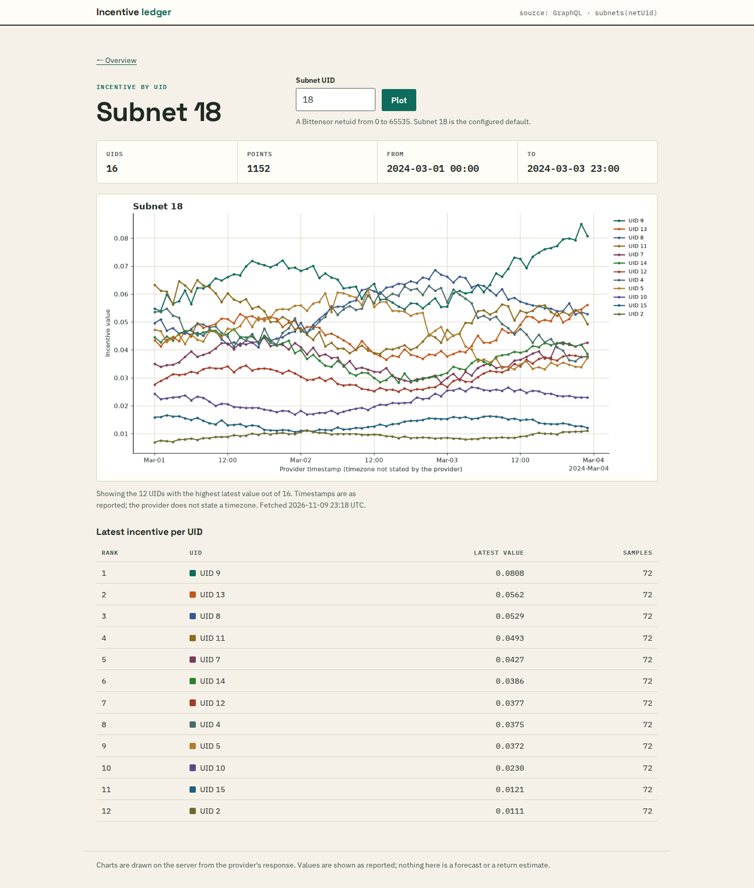
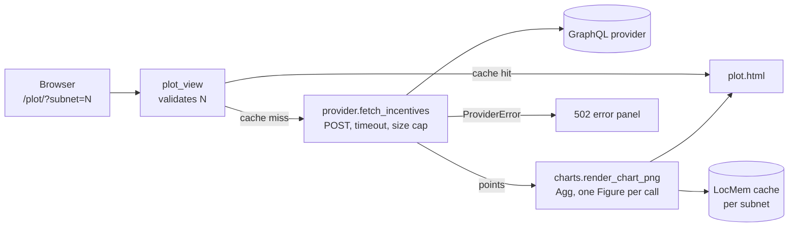
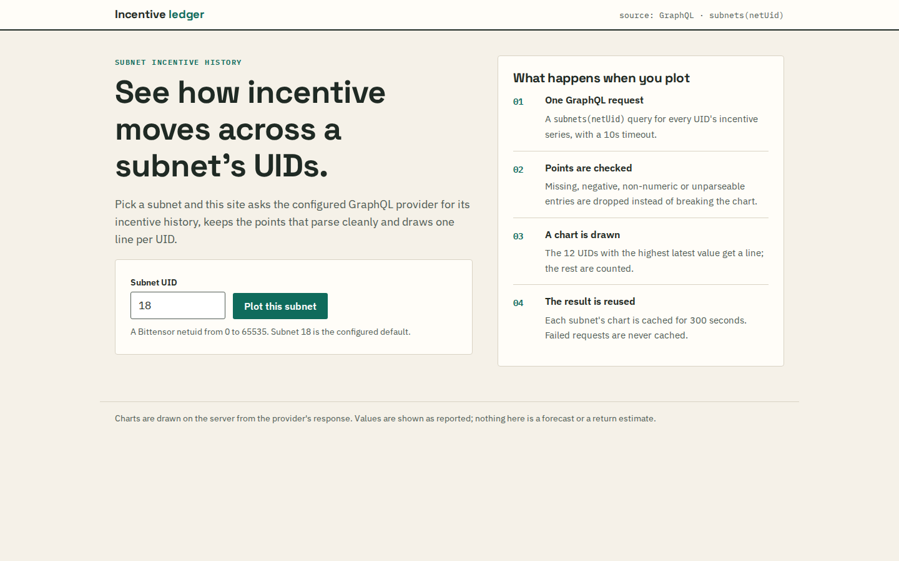
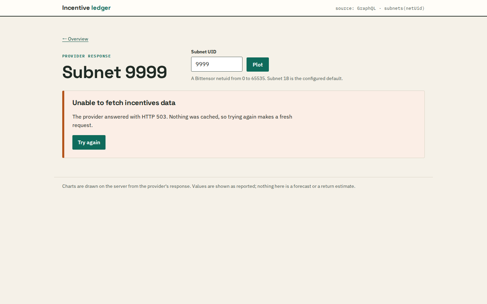
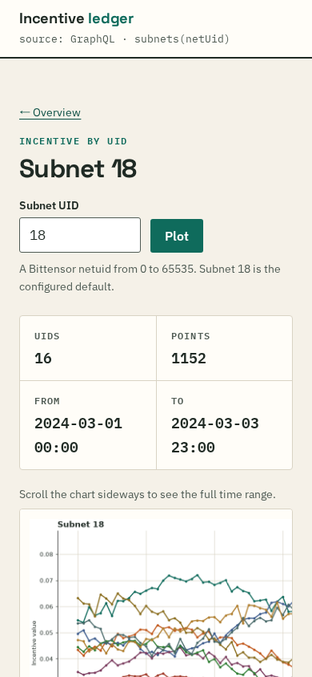
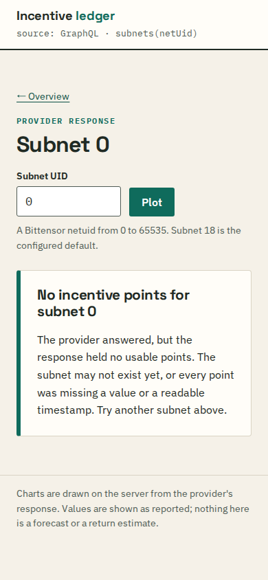

# Incentive ledger

A small Django site that charts Bittensor subnet incentive history. You pick a subnet number; the server sends one GraphQL query to a configured provider (by default the public TaoMarketCap endpoint), keeps the points that parse cleanly, and renders a Matplotlib chart with one line per UID next to a ranked table of each UID's latest value.

It consumes GraphQL; it does not implement a GraphQL server. It does not forecast, estimate returns or store history.



All screenshots in this README come from `scripts/demo_provider.py`, an offline stand-in that serves **synthetic** data. They are not real subnet values.

## How a request flows



| Situation | Status | What the page shows |
|---|---|---|
| Points returned | 200 | Stats strip, chart, ranked UID table |
| Provider answered with no usable points | 200 | "No incentive points for subnet N" |
| Provider unreachable, timed out, non-200, non-JSON, GraphQL `errors`, or body over the size cap | 502 | Error panel with the reason and a retry link |
| `subnet` is not a whole number from 0 to 65535 | 400 | The form with an inline error; no request is sent |

## Run it

Python 3.12 is pinned in `.python-version`, `runtime.txt` and the Dockerfile.

### With Docker

```sh
docker build -t incentive-ledger .
docker run --rm -p 8000:8000 \
  -e DJANGO_SECRET_KEY="$(python3 -c 'import secrets; print(secrets.token_urlsafe(50))')" \
  -e DJANGO_SECURE_COOKIES=false \
  incentive-ledger
```

Open http://127.0.0.1:8000/. The container runs gunicorn as an unprivileged `app` user. `DJANGO_SECURE_COOKIES=false` is only for plain-HTTP local use; leave it at its default behind HTTPS.

### Offline, against synthetic data

The demo provider needs only the standard library. Subnet `0` returns an empty series and subnet `9999` returns HTTP 503, so every page state can be seen without touching the real API.

```sh
docker network create incentive-demo
docker run -d --rm --name demo-provider --network incentive-demo \
  incentive-ledger python scripts/demo_provider.py --host 0.0.0.0
docker run --rm -p 8000:8000 --network incentive-demo \
  -e DJANGO_SECRET_KEY="$(python3 -c 'import secrets; print(secrets.token_urlsafe(50))')" \
  -e DJANGO_SECURE_COOKIES=false \
  -e GRAPHQL_API_URL=http://demo-provider:8765/graphql \
  incentive-ledger
```

### In a virtual environment

```sh
python3.12 -m venv .venv
source .venv/bin/activate
pip install -r requirements-dev.txt
export DJANGO_DEBUG=true
python manage.py runserver 127.0.0.1:8000
```

For offline use, run `python scripts/demo_provider.py` in a second terminal and export `GRAPHQL_API_URL=http://127.0.0.1:8765/graphql` before `runserver`. `migrate` is only needed if you want the Django admin; the charts never touch the database.

## Configuration

Settings come from process environment variables. `.env.example` lists them all with comments; it is a reference and is **not loaded automatically**.

| Variable | Default | Notes |
|---|---|---|
| `DJANGO_DEBUG` | `false` | `true`/`1`/`yes`/`on`. Debug mode may run without a secret key (a throwaway one is generated). |
| `DJANGO_SECRET_KEY` | none | Required whenever debug is off. |
| `DJANGO_ALLOWED_HOSTS` | `127.0.0.1,localhost` | Comma-separated. `*` is refused unless debug is on. |
| `DJANGO_CSRF_TRUSTED_ORIGINS` | empty | Needed for admin logins behind HTTPS. |
| `DJANGO_SECURE_COOKIES` | `true` | Secure session/CSRF cookies outside debug. |
| `DJANGO_SECURE_SSL_REDIRECT`, `DJANGO_SECURE_HSTS_SECONDS`, `DJANGO_BEHIND_TLS_PROXY` | off / `0` / off | Opt in once you know how TLS is terminated. |
| `GRAPHQL_API_URL` | `https://api.taomarketcap.com/graphql` | Any endpoint that answers the same query shape. |
| `GRAPHQL_SUBNET_UID` | `18` | Subnet shown when `/plot/` has no `?subnet=`. |
| `GRAPHQL_REQUEST_TIMEOUT` | `10` | Seconds, at least 0.5. |
| `GRAPHQL_CACHE_SECONDS` | `300` | Per-subnet chart cache; `0` disables it. |
| `GRAPHQL_MAX_RESPONSE_BYTES` | `5000000` | Larger provider bodies are rejected. |

Invalid numbers stop startup with a message naming the variable.

## The provider query

`provider.build_incentives_query` sends this, with the subnet number validated as an integer first:

```graphql
query SubnetIncentives {
  subnets(netUid: 18) {
    uids { incentive { uid data { value valueBlockNumber timestamp blockNumber } } }
  }
}
```

A trimmed response from the demo provider, in the shape the parser expects:

```json
{
  "data": {
    "subnets": [
      {
        "uids": [
          {
            "incentive": {
              "uid": 0,
              "data": [
                { "value": "0.010741", "timestamp": "2024-03-01:00:00:00", "blockNumber": 2400000 },
                { "value": "0.010884", "timestamp": "2024-03-01:01:00:00", "blockNumber": 2400300 }
              ]
            }
          }
        ]
      }
    ]
  }
}
```

The parser also accepts an older flattened shape (`uids: [{uid, data}]`). Points with a missing, negative, non-finite or boolean value, or a timestamp that is not `%Y-%m-%d:%H:%M:%S`, are dropped. The provider does not state a timezone, so the page says so instead of assuming UTC.

## Design choices

- **The project package is `incentive_site`.** It used to be called `graphql`, which shadows the `graphql-core` import name and would have broken any GraphQL client library added later.
- **No shared pyplot state.** Each chart is a fresh `matplotlib.figure.Figure` on the Agg backend, so concurrent requests in threaded servers cannot draw on each other's axes.
- **At most 12 lines.** A full subnet has up to 256 UIDs. The 12 with the highest latest value get a line and a table row; the page says how many were left out.
- **Caching is deliberately simple.** Django's local-memory cache keeps one rendered chart per subnet. Each gunicorn worker has its own copy, so with two workers a subnet can be fetched up to twice per cache period. Failures are never cached, so a retry always makes a new request.
- **Redirects are refused.** The provider request does not follow redirects, and any non-200 answer is treated as a failure.

## Screenshots

| | |
|---|---|
|  |  |
|  |  |

Also captured: [invalid input on a phone](docs/screenshots/invalid-mobile.png) and the [standalone chart image](docs/screenshots/synthetic-chart.png). To regenerate them, start the demo provider and the site as above, then run `scripts/screenshots.py` with Playwright for Python 1.64 installed (`pip install playwright==1.64.1 && playwright install chromium`):

```sh
python scripts/screenshots.py http://127.0.0.1:8000 docs/screenshots
```

The script fails if any page logs a console error or scrolls horizontally.

## Tests and lint

```sh
python manage.py test --settings=incentive_site.test_settings
ruff check . && ruff format --check .
```

33 tests cover response parsing, every provider failure mode (mocked with `responses`; no test touches the network), chart rendering including concurrent renders, caching, input validation, the page states and the settings module under different environments.

## Limits

- No persistence of incentive samples, background refresh or pagination; every cache miss is one blocking provider request plus a chart render.
- The query and timestamp format were written against the provider's response at the time; there is no schema check, so a provider change shows up as an empty or error state.
- `Procfile` and `vercel.json` point at `incentive_site.wsgi` but have not been deployed or tested on those platforms.
- Public deployment would also want request throttling and a shared cache.

## License

MIT; see [LICENSE](LICENSE).
